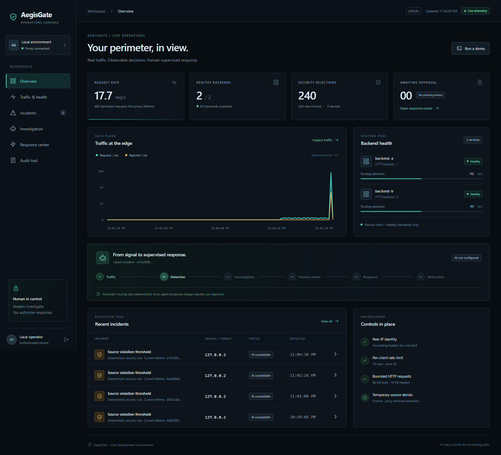

# AegisGate

**Agentic AI cybersecurity and load balancing platform**

A real C++ HTTP reverse proxy with deterministic security controls, an evidence-seeking investigation agent, and a human-supervised response console.

**Traffic → detection → investigation → recommendation → approval → action → verification → audit.**

The model stays outside request forwarding. A provider outage leaves the proxy operational. Every state-changing response uses an explicit bounded catalog and an authenticated operator decision.



*Actual local synthetic traffic; provider unconfigured in this capture. Chart values and incidents come from the running proxy.*

## What works

- Real HTTP/1.1 forwarding, healthy-backend round robin, active health checks, failure removal, and recovery.
- Peer-IP/CIDR filtering, per-client rate limiting, connection and message limits, and structured detections.
- One model-directed investigator selecting bounded read tools, citing actual evidence, explaining alternatives and uncertainty, and optionally proposing a temporary source deny.
- Exact proposal fingerprints, short approval windows, current-state checks, idempotent proxy enforcement, autonomous TTL expiration, and outcome verification.
- Functional traffic, incident, investigation, response, and audit views with live/historical and model/manual/fixture labels.
- A labeled manual operator fallback when the provider is unavailable, plus repeatable security and reliability demonstrations.

This is a local portfolio MVP with explicit limits. It is not a complete firewall, WAF, SIEM, DDoS defense, or production-ready gateway. See the [HTTP contract](docs/http-contract.md) and [threat model](docs/security.md).

## Run locally

Prerequisites: **Node.js 22.14+**, **Python 3.12+**, and **g++ with C++20 support** on PATH. Linux and Windows native builds have been exercised. On Node 22, the built-in SQLite module prints an experimental-feature warning. Node 24 is the container runtime target. CMake 3.20+ is an optional build alternative.

From the project directory:

```sh
npm ci
npm run setup
npm run build:proxy
npm run dev
```

The first C++ build downloads checksum-verified Boost 1.90.0 into ignored `.deps/`; its source archive is about 211 MB. Subsequent builds reuse the extracted headers. If PowerShell execution policy blocks `npm`, use `npm.cmd` for these commands. Set `CXX` to an absolute compiler path if the desired g++ is not first on PATH.

Open **http://127.0.0.1:4174**. Read `AEGIS_OPERATOR_PASSWORD` from the generated, ignored `.env` to sign in. Operator passwords have no minimum length; setup still generates a strong random default. If setup was skipped, credentials are generated in `.runtime/secrets.json`. Credentials are never intentionally printed into model context or audit records.

The native launcher starts:

| Component | Local address |
| --- | --- |
| Public reverse proxy | `127.0.0.1:8180` |
| Operator console | `127.0.0.1:4174` |
| Private proxy management | `127.0.0.1:9090` |
| Synthetic backends | `127.0.0.1:8101`, `127.0.0.1:8102` |

`npm run dev` builds the dashboard and starts the local stack with demo buttons enabled. In the **Load balancer visualizer**, click **Start normal traffic**, **Stop backend A**, then **Restart backend A** to demonstrate routing and recovery. Ctrl+C stops the owned local stack. Ports must be free; the launcher does not terminate unrelated services. Windows process-tree termination is distinct from the tested POSIX graceful-drain behavior.

## Enable live investigation

Set `OPENROUTER_API_KEY` in `.env` and choose an explicit `OPENROUTER_MODEL` supporting strict JSON Schema output, then restart the stack. The default model ID is `openai/gpt-4.1-mini`; compatibility and credits depend on the configured provider account. Never commit the key.

Without a key, the console explicitly reports investigation unavailability. Deterministic evidence and clearly labeled **manual operator proposals** still support the response demonstration. No fixture response is presented as a live model result. [Agent workflow and limits](docs/agents.md).

## Demonstrate the lifecycle

Run `npm run dev`, sign in, and use the **Load balancer visualizer** on Overview or Traffic & health. Start traffic, stop Backend A, watch new requests go to B, then restart A. Dots replay observed completed requests; backend counts and shares cover the proxy lifetime. For the security scenario, click **Run a demo** to send a burst, review the incident, and check the response. Security responses still require your separate approval. See the [guided demo](docs/demo.md).

For optional command-line traffic, use a second terminal:

```sh
npm run demo:traffic
npm run demo:traffic -- --mode burst
```

Normal traffic uses `127.0.0.1`; the bounded burst uses the designated `127.0.0.2` client. Inspect the resulting incident, evidence and finding. Review a proposed deny, explicitly approve it, and repeat both clients to collect target-denial and successful control-traffic evidence. The rule expires on the proxy's clock. Follow the [complete security and reliability script](docs/demo.md).

## Containers

With Docker Engine/Desktop and Compose v2:

```sh
npm run setup
docker compose up --build -d
docker compose --profile demo up -d normal
docker compose --profile demo up --force-recreate burst
```

The console and proxy are published only on host loopback. Separate client and operations networks give the synthetic clients fixed source addresses. `docker compose down` preserves the named audit volume. Container definitions are supplied; see [validation](docs/validation.md) for the actual execution status on this host.

## Verify

```sh
python scripts/build_proxy.py --core
npm test
npm run test:proxy
npm run test:e2e
npm run build
npm run build:runtime
npm audit
```

The end-to-end test uses **real sockets and the real C++ proxy** with an **explicit model fixture**. It also starts the actual investigator without a provider key, verifies forwarding continues, simulates an authenticated operator decision, and observes 60-second expiry with the control plane stopped. It takes about one minute. Provider fixtures test adapter contracts, not live model quality.

With the local stack already running and Edge/Chromium available, `npm run test:browser` checks actual sign-in, synthetic detection, all views and mobile layout, saving screenshots in `.runtime/review/`. It does not approve an action; an already configured runtime provider may investigate the generated incident. Set `AEGIS_BROWSER_EXECUTABLE` if needed. [Executed results and limitations](docs/validation.md).

## Design and evidence

- [Architecture, interfaces and trade-offs](docs/architecture.md)
- [Supported HTTP behavior and exclusions](docs/http-contract.md)
- [Threat model, controls, approval and privacy](docs/security.md)
- [Investigator tools, provider and outcome review](docs/agents.md)
- [Repeatable demonstrations](docs/demo.md)
- [Accurate AI-assistance and owner-role account](docs/ai-assistance.md)
- [Third-party notices](THIRD_PARTY_NOTICES.txt)

## Known limits and roadmap

The MVP buffers messages, closes connections, serves IPv4 HTTP/1.1, runs one proxy event-loop thread, and uses one local operator identity. There is no automatic POST retry, TLS termination, trusted-forwarding-header mode, general rule editor, backend provisioning, external immutable audit store, or database retention policy. Temporary rules intentionally disappear on proxy restart and invalidate old approvals.

Next: retained-history storage policy, stronger operator identity, telemetry export, upstream connection reuse, broader protocol coverage with dedicated framing tests, and additional bounded response types. Add an independent verifier agent only if it demonstrates a concrete advantage. TLS/HTTP2, orchestration and real autoscaling are future work, not implemented claims.
