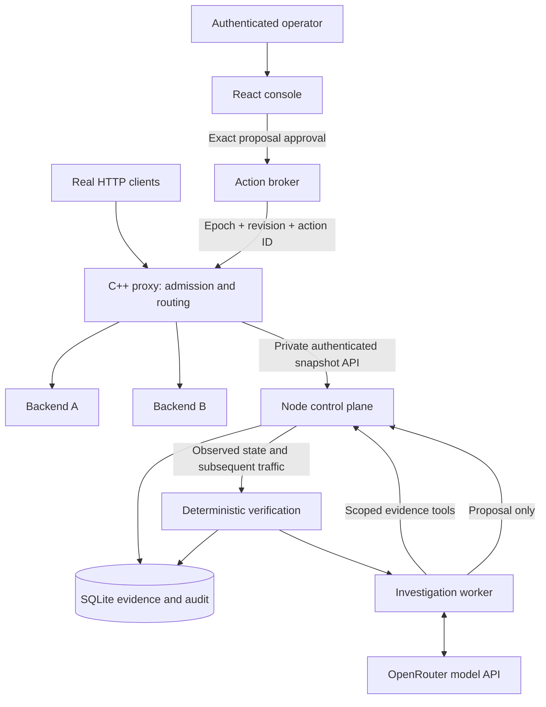

# Architecture and implementation boundaries

AegisGate serves real HTTP traffic and gives a local operator evidence for small, reversible responses. It is intended for a developer demonstrating network behavior and supervised agent operations, not an Internet-facing security service.

## Components

| Component | Responsibility | Interface |
| --- | --- | --- |
| C++ data plane | Parse bounded HTTP/1.1, enforce source and rate controls, select healthy backends, forward, emit telemetry | Public listener; separate bearer-authenticated management listener |
| Deterministic detectors | Count repeated source violations and backend health failures | Structured detection events with IDs, sequence, time, source/target and rule evidence |
| Control plane | Poll snapshots every 500 ms, deduplicate events, create incidents, track freshness and proxy lifetimes | Operator API and separately authenticated investigator API |
| Investigator process | Make actual model calls, choose evidence tools, revise a concise plan, produce findings and optional proposals | Four bounded read tools; proposal endpoint; no approval grant |
| Broker | Validate incident evidence, target, parameters, proposal hash, human session and configuration version | Explicit temporary-deny catalog only |
| Verifier and audit | Correlate applied rule with later denied target traffic and successful control traffic; retain linked audit records | SQLite and operator views |

## Request path and failure independence

The model, SQLite, and operator dashboard are outside HTTP forwarding. The proxy uses one Asio event-loop thread; request, health-check and management handlers run there. No model call or database write executes in that loop. Management snapshot serialization shares this thread and has bounded event/action collections; this is a known scaling limitation, not a benchmarked throughput guarantee.

Backends start in an unconfirmed state. Two successful configured checks admit them by default. Two failed checks remove them. A failed request is not automatically retried on a different backend: retrying a POST could duplicate effects. Health recovery changes routing automatically and does not consume an agent approval.

An unavailable provider produces an unavailable investigation record. Deterministic routing, detection, security controls, and manual operator proposals continue working. A stopped control plane stops new investigations and telemetry collection; the proxy continues forwarding and expiring existing temporary rules.

## State and concurrency

The proxy creates a new random epoch at startup. Its revision changes when a temporary rule is applied or expires. The broker binds proposals to both. A proxy-side version check and action ledger prevent stale state or altered retries from bypassing approval. It retains up to 1,024 applied action identities for its lifetime and refuses further actions at capacity rather than evicting retry protection.

SQLite records approval and execution intent before the network mutation. The database transaction and proxy mutation are separate operations. A missing acknowledgement is labeled uncertain; polling reconciles it against the proxy ledger. This avoids pretending the two processes share a transaction. Proxy restarts discard temporary rules and invalidate previous versions; the control plane records the interruption and never silently reapplies an old approval.

The proxy retains 2,048 telemetry events and explicitly exposes the oldest sequence. The collector records missed sequences and resets chart samples on a new epoch. SQLite history currently has no automatic retention or rotation; long-running operation needs a storage policy.

## Container topology

Compose separates the synthetic client network (`172.30.0.0/24`) from operations/backends (`172.31.0.0/24`). The proxy joins both. Its management listener binds only its operations address; only the public proxy port and operator console are published, both on host loopback. The designated burst client is `172.30.0.11`; the normal client is `.10`. Model-proposed denies are eligible only for the burst address. Containers run as unprivileged users with dropped capabilities; the console's audit directory is the sole persistent writable application volume.

## Trade-offs

C++/Beast exposes real network ownership and deadlines while providing HTTP parsing. TypeScript keeps agent and operator contracts inspectable. SQLite reduces setup complexity and gives durable local records but remains a single local store. One investigator gives demonstrable tool selection without adding nominal specialist roles. Buffered messages and connection close simplify framing at the cost of streaming and connection reuse.
